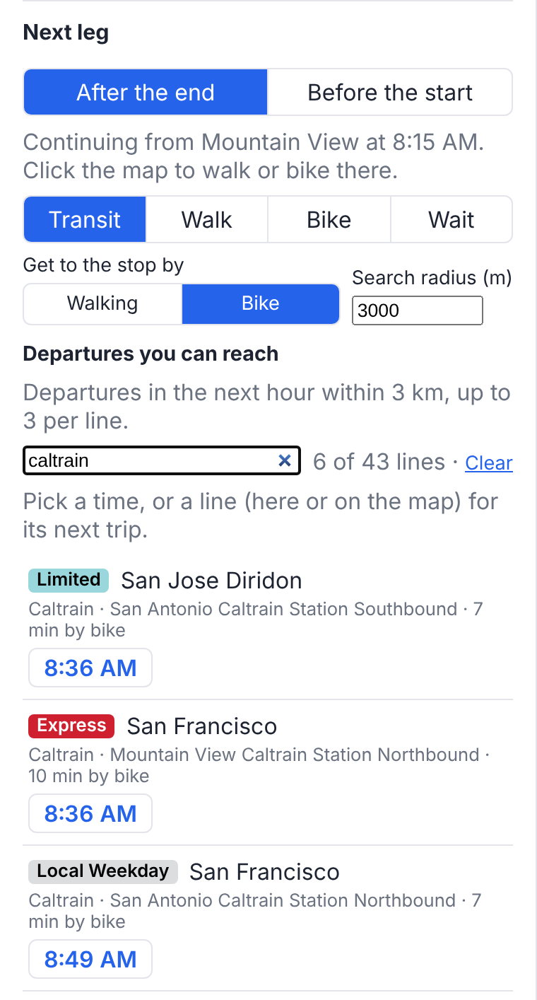
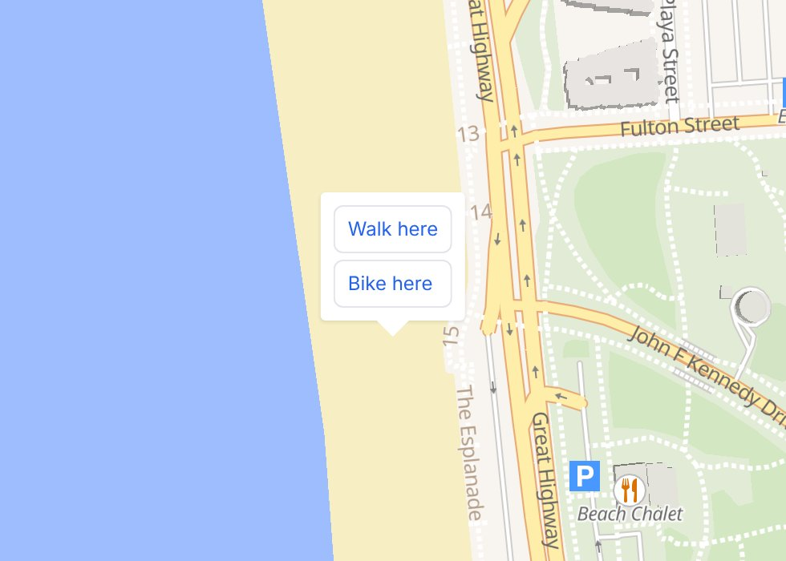
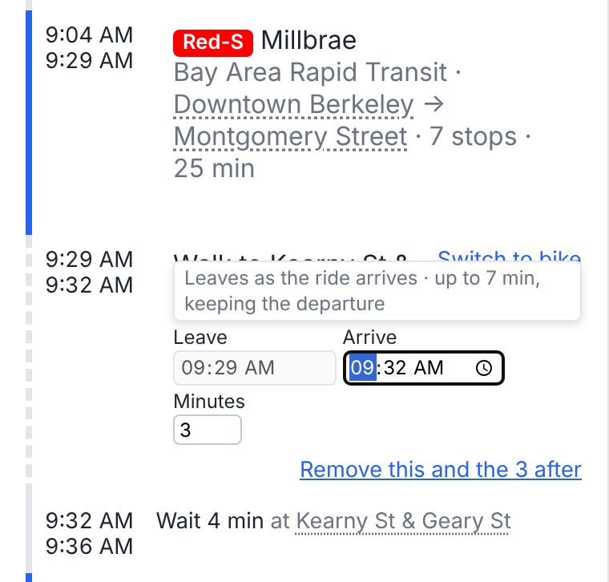
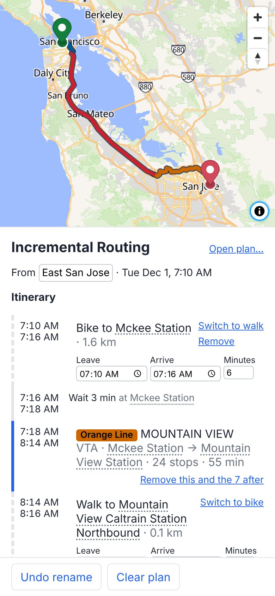
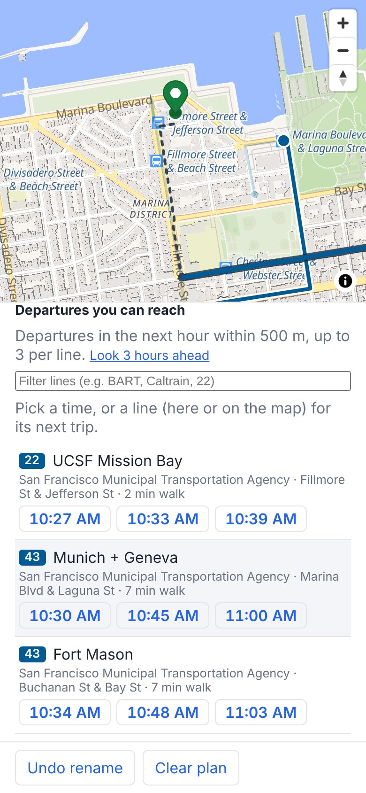

# Incremental Routing

Plan a multi-leg trip one leg at a time, mixing Bay Area transit (every operator, from
511.org's regional feed) with walking and cycling. See [PLAN.md](PLAN.md) for the concept, data
sources, architecture, decisions and what's next.

**Status:** MVP complete (milestones M0–M5), plus refinements (M6–M7), packaged for Docker
(M8), with line previews on the map (M9), fewer clicks (M10), leg merging (M11) and a
smoother flow (M12).

- Build a trip forwards and backwards from transit, walk, bike and wait legs.
- The lines nearby are listed as soon as you choose Transit, and the map shows where each one
  goes. Pick lines and stops in the list or on the map, and filter them as you type.
- Click the map to walk or bike there.
- Bike or walk to and from stops, and edit when walks, rides and waits leave or arrive.
- Rename places where they're shown, remove legs mid-trip, and undo any step, even after a
  reload.
- Departures are listed by line. Transfer warnings come from the agencies' own rules.
- Hilly bike rides show a simple height profile.
- Print the trip with a map, or export it as CSV, a calendar file or a JSON plan that you can
  open again or send to someone.
- The plan is autosaved in your browser.

## Examples

Five trips planned in the app for a Tuesday morning: four from a single bus ride to a trip
across three agencies, and one that goes the long way on purpose. Each shows the itinerary on
the left and the whole trip on the map. Close-ups of each step are under [Using it](#using-it).

**One bus line.** Union Square to Ocean Beach in San Francisco: a short walk to the stop, a
two-minute wait, the Muni 38R along Geary, and a walk to the beach.


**A simple transfer.** Downtown Berkeley to Washington Square: BART to Montgomery Street, a
short walk and a four-minute wait, then the Muni 30 to North Beach.


**Biking to, between and from transit.** Mountain View to Lake Merritt: bike to Caltrain, ride
the Express to San Francisco, bike across the city to the Ferry Building, take the ferry to
Oakland and bike to the lake.


**Three agencies, three kinds of transit and a bike.** East San Jose to the Marina: bike to
VTA's Orange Line, take the light rail to Mountain View, Caltrain to San Francisco and the
Muni 30 bus to the Marina, walking at each change.


**The long way, for fun.** Sunnyvale Caltrain to San José airport. A journey planner would send
you on the 9:28 Caltrain to Santa Clara and then the 60, into Terminal A at 10:03. Here you
choose every ride instead, across three agencies: the 9:09 Caltrain Express past the airport to
San José Diridon, the Rapid 500 to Berryessa, BART one stop to Milpitas, and the 60 from the
other end of its route, into Terminal A at 10:39. Planning one leg at a time makes room for a
ride you want to take, not just the quickest one.


## Run it with Docker

This is the easy way, on a home server or on your own computer. You need:

- Docker with Compose: Docker Engine on Linux, or Docker Desktop on Windows and macOS;
- about 1 GB of disk;
- a free 511.org API token: <https://511.org/open-data/token>.

```sh
git clone https://github.com/DanielKarp/incremental_routing.git
cd incremental_routing
cp .env.example .env              # then put your token in .env: API_511_KEY=...
docker compose up -d --build
```

Open <http://localhost:8000>.

- **First start.** The app downloads the transit data and builds its database, which takes
  about a minute. Reload the page once it's done.
- **Data refresh.** The data is checked every few hours and downloaded again once it's a week
  old. `REFRESH_DAYS` in `.env` changes that.
- **Storage.** The data lives in a Docker volume, so it survives restarts and updates.

Day to day:

| To | Run |
| --- | --- |
| Update to the latest version | `git pull && docker compose up -d --build` |
| See what it's doing | `docker compose logs -f app` |
| Fetch fresh schedules now | `docker compose exec app ir-load-gtfs` |
| Stop it | `docker compose down` (the data is kept) |

The app listens on this machine only. To reach it from other devices on your network, set
`BIND=0.0.0.0` in `.env` and use the machine's address. The app has no logins of its own, so
don't open it to the internet directly; use the tunnel below instead.

### Share it with friends through a Cloudflare tunnel

A Cloudflare tunnel gives the app a web address without opening ports on your router.
Cloudflare Access then asks visitors for an emailed one-time code, so only the people you list
get in. Both are free, for up to 50 people. You need a domain whose DNS is on Cloudflare.

1. In the Cloudflare Zero Trust dashboard, create a tunnel (type *Cloudflared*). Copy its
   token into `.env` as `TUNNEL_TOKEN=...`.
2. Give the tunnel a public hostname, such as `trips.example.com`, pointing to the service
   `http://app:8000`.
3. Under Access, add a *self-hosted* application for that hostname. Its policy should allow
   your friends' email addresses, with one-time PIN as the login method. Don't skip this step:
   without it, anyone who finds the address can use the app.
4. Start the app and the tunnel:

   ```sh
   docker compose --profile tunnel up -d --build
   ```

Your friends open `https://trips.example.com`, enter their email and the code they receive,
and plan away. Each person's plans stay in their own browser; they can save them as JSON files
to keep or share. Cloudflare's guides cover the details:
[tunnels](https://developers.cloudflare.com/cloudflare-one/connections/connect-networks/) and
[self-hosted applications](https://developers.cloudflare.com/cloudflare-one/applications/configure-apps/self-hosted-apps/).

### Settings

Everything goes in `.env`; [.env.example](.env.example) lists each setting.

- `API_511_KEY` is the only one you must set.
- Walk and bike routes come from the public FOSSGIS Valhalla server (fair use, no key). Its bike
  times already allow for hills.
- `ROUTING_PROVIDER=straight-line` works without any routing service.
- `ROUTING_PROVIDER=ors`, with an `ORS_API_KEY`, uses openrouteservice instead. Its bike times
  ignore hills, and it gives no height profiles.

## Develop without Docker

You need Python 3.11+ with [uv](https://docs.astral.sh/uv/), Node 22.12+, and the same `.env`
at the repository root. Each block starts from the repository root, in its own terminal; both
must keep running.

```sh
# Backend (first terminal)
cd backend
uv sync
uv run ir-load-gtfs         # downloads the 511 regional feed, then builds data/gtfs.sqlite
uv run uvicorn --factory incremental_routing.api:create_app --reload   # http://127.0.0.1:8000

# Frontend (second terminal)
cd frontend
npm install
npm run dev                 # http://localhost:5173 (proxies /api to the backend)
```

After `npm run build`, the backend also serves the built app at <http://127.0.0.1:8000>, as it
does in Docker.

**The transit data.**

- It's 511.org's regional feed: one GTFS feed for every Bay Area operator. That's 41 agencies,
  including Caltrain, BART, VTA, Muni, AC Transit, SamTrans, Golden Gate Transit and the
  ferries.
- The download is about 60 MB. Building takes about a minute and gives a database of about
  620 MB. The key is never printed, even when a download fails.
- Re-run `uv run ir-load-gtfs` every month or so. Agencies update their schedules at different
  times, so the load summary lists any agency whose schedule ends within 30 days. The app also
  names any agency whose schedule doesn't cover the day you're planning.
- `uv run ir-load-gtfs --skip-download` rebuilds from the feed already on disk. Run it after
  pulling an update if the app says the database was built by an older version.

## Using it

1. **Plan from a point.** Click the map and set the time. It can be where you set off, where
   you need to be, or anywhere in between. Give it a name such as "Home". Until you add the
   first leg you can drag its pin, or click the map and choose *Move the start here*; *Undo*
   puts it back.
2. **Add legs** under *Next leg*. Choose *After the end* to plan forwards or *Before the
   start* to plan backwards, then a mode:
   - **Transit:** the lines nearby are listed straight away. Each gets a row with up to three
     departures in the next hour (or, backwards, arrivals in the hour before). The list
     updates itself when you change how you'll reach the stop (*Get to the stop by Walking*
     or *Bike*; backwards, how you'll leave it) or the search radius, and after every leg you
     add. Type in *Filter lines* to narrow it, and the map, to a line, a stop or an operator:
     "22", "muni ocean" or "bart, caltrain". If nothing turns up, it offers *Search within
     1 km* and *Look 3 hours ahead*.

     The map shows those lines too, thin and faded in their own colours, each with a dot at
     the stop where you'd catch it. Forwards, a line runs from that stop to the end of its
     route; backwards, from the start of its route to the stop. Point at a row to highlight
     its line, and rest there a moment to zoom to it (the map goes back when you move away).
     Scrolling the list, or sweeping the pointer across it, leaves the map where it is. Point
     at a line on the map to see its next time, its stop and the walk there.

     

     With *Get to the stop by Bike* and a wider radius, each row gives the ride to its stop:

     

     Pick a time, or click a line's name for its next departure (or last arrival). You can
     also click the line itself on the map; where lines overlap, *Which line?* lists them by
     time. Then choose the stop where you get off (or on), in the list or on the map. The walk
     or bike ride to or from the stop, and any wait, are added for you. If that walk or ride
     would miss the trip, the list of stops says so, with a button for the line's next trip
     you can make (*Take the 9:55 AM instead*). *← Lines* stays at the top while you scroll
     the stops; it, or Escape, goes back to the list as you left it.

     

     When you change from another ride, the list notes the agency's transfer rules. It warns
     when a connection is shorter than the agency's minimum, or when the agency says the
     transfer isn't possible. You can still choose a warned trip. Changes between different
     agencies have no rules, so judge those yourself.
   - **Walk / Bike:** click the map where you're going (or coming from), check the preview,
     name the place and add the leg (Enter adds it too). *Bike instead* / *Walk instead*
     routes the same point the other way. A bike ride that climbs or descends at least 20 m
     shows a small height profile, with its total climb and descent.

     Quicker: in Transit or Wait mode, click the map (or right-click it, in any mode) and
     choose *Walk here* or *Bike here* (backwards, *Walk from here* or *Bike from here*). The
     leg is added straight away, and *Next leg* stays as it was. A point within 75 m of a
     place you named takes its name, so the walk back home is "Home" again; otherwise it's
     named after a stop nearby (or its coordinates).

     
   - **Wait:** add a stop of a set number of minutes, e.g. for coffee. One click on *5*, *10*,
     *15* or *30 min* adds it, and *Next leg* then goes back to the mode you had.
3. **Adjust** the plan in the itinerary.
   - Change when walk, bike and wait legs leave or arrive, or how long they take; click into
     a time to see how far it can move. An end that meets a ride directly is fixed. Next to a
     wait, or at either end of the plan, it can move. A leg can't run into its neighbours.

     
   - *Switch to bike* / *Switch to walk* re-routes a leg.
   - Click a place's name, in a leg or in the *From* line, and type over it. Enter renames it
     everywhere it appears, and Escape puts it back. *Rename places* lists every place.
   - Where two walks, two bike rides or two waits meet, *Merge into one…* joins them into one
     leg. The times stay the same, and the place in between drops out of the plan.
   - **Remove** takes off the first or last leg, or a wait you added. A leg in the middle goes
     with the legs after it: point at its row for *Remove this and the 3 after* (backwards,
     *before*).
   - **Undo**, pinned to the bottom of the panel, says what it will undo ("Undo remove") and
     steps back through every change. Ctrl+Z (Cmd+Z on a Mac) does the same, and the steps
     survive a reload.
4. **Finish** with *Summary & export*. It shows a map of the whole trip and the itinerary.
   - Print both.
   - Download a CSV, or add the trip to your calendar (.ics).
   - *Save plan (.json)* to keep the plan or send it to someone. *Open plan…* (top of the
     page) loads it again.

   

**Good to know.**

- After each leg the panel scrolls back to *Next leg*, which says what was added. Messages show
  where you're working: under the mode buttons in *Next leg*, or under the leg they're about.
- A double-click (or double tap) on the map only zooms, so a click on empty map acts a moment
  later. On a touch screen, a long press opens the map's menu.
- Escape steps back out of what you're doing: it closes a menu on the map or the summary,
  cancels a move or a walk or bike leg you haven't added, or leaves the list of stops. A field
  you're typing in keeps it.
- On a phone, the map stays at the top of the screen and only the panel below it scrolls, so
  what you pick in the list shows on the map. Held sideways, the panel sits beside the map.

   

## Tests

```sh
cd backend && uv run pytest && uv run ruff check .
cd frontend && npm test && npm run build
```

The backend tests run against a small synthetic GTFS feed (`backend/tests/conftest.py`). It
covers trips past midnight, holiday exceptions, stops without scheduled times, parent stations,
the daylight-saving change day, shapes and transfer rules.

## License

The code is released under the [MIT License](LICENSE). The data it uses comes from the services
below, under their own terms.

## Data and attribution

- Transit schedules: the 511 SF Bay regional GTFS feed (511.org open data).
- Map: © OpenStreetMap contributors, tiles by OpenFreeMap. Rendered with MapLibre GL JS.
- Walk and bike routing and heights: Valhalla (FOSSGIS public server), or openrouteservice
  (HeiGIT) if you choose it.
